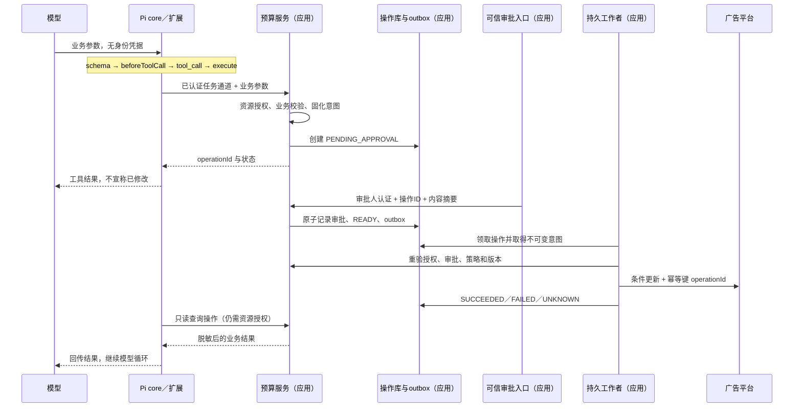

# 设计工具调用鉴权与安全：从服务端执行链到 Pi 的实现

> 面向 AI Agent 与服务端工程同事；示例是假设设计，不代表 dy 已实现。Pi 源码核实于 2026-11-09（Asia/Shanghai，UTC+8），固定提交见文末。

工具调用的安全，不能设计成“模型选一个函数，弹窗点同意，然后执行”。模型能生成格式正确的请求，却不能替服务端证明调用者有权修改这个资源；一次 HTTP 超时，也不能证明修改没有发生。可落地的做法，是把工具请求先变成一笔服务端操作，再让授权、审批和执行都围绕这笔操作展开。下面用一次广告预算修改推导这条执行链，并说明 Pi 已经提供哪些入口，哪些组件仍要应用自己实现。

假设用户要求 Data Agent 将计划 A 的**人民币日预算从 1000 元改为 1200 元**。接口按整数分计价，目标值是 `120000`，币种是 `CNY`，读取到的资源版本是 `v17`。金额、版本和后面的状态均为设计示例，不是实际操作记录。

## 从“直接调 API”开始，问题首先出在谁代表谁

最容易写出的工具，接收 `tenantId、planId、amount`，拿服务端 token 去广告平台修改预算。它可能完全符合 schema，却仍然危险：如果后端信任模型填写的 `tenantId`，又不检查计划归属和资源动作权限，请求就可能改到别的租户。这里错的是后端授权边界，不是参数有没有被模型“理解”。

因此，先拆开两类输入。**模型只提供业务意图，身份来自可信调用链。**

| 输入 | 例子 | 谁提供、怎么验证 |
| --- | --- | --- |
| 业务参数 | 计划 A、日预算 120000 分、CNY、预期版本 v17 | 模型提出，服务端按业务规则校验 |
| 可信上下文 | 操作者、租户、任务委托、操作槽位 | 网关认证会话或工作负载身份后建立，不接受请求体覆盖 |

“操作槽位”是宿主为本次用户指令分配的业务位置，用来让重复工具请求找到同一笔操作。它不是模型的 `toolCallId`，也不是授权凭证。用户明确发起另一笔修改时，宿主才分配新的槽位。

预算服务按可信租户范围查询计划 A，再检查操作者是否拥有该计划的 `budget.update` 权限，包括账户范围和委托限制。接着检查金额是整数分、币种与账户相同、预算周期确实为日、目标金额符合租户策略。即使网关已验证登录，资源动作授权仍得在预算服务做，因为登录不能证明这个人能改这条计划。

如果把后端拆成“申请接口”和“执行接口”，也不能只保护申请接口。执行接口和只读状态接口都要验证操作归属，避免猜到一个 operationId 就能执行或查看别人的操作。操作 ID 是查找记录的键，不是持有即授权的令牌。

这样，Pi 工具就不应持有广告平台的全权能力。它只调用预算服务；预算服务才有资格取得平台凭据并提交修改。先收拢这条写路径，后面的确认和审计才有一个不会被普通业务调用绕开的落点。

## Pi 的 schema 和 hook 放在哪里，为什么还需要后端重验

Pi 自定义工具通过 `pi.registerTool()` 注册，`parameters` 描述参数 schema，`execute(toolCallId, params, signal, onUpdate, ctx)` 承接执行。[1] schema 解决的是“输入长什么样”，不能查询“用户对计划 A 有什么权限”。

本次版本的 core 调用路径是：按名字查工具，运行可选的 `prepareArguments`，校验参数，再调用 `beforeToolCall`；允许后才进入 `execute`。未知工具、参数错误和调用前阻断会成为错误工具结果，而不是继续执行。[2]

coding-agent 在这条路径上把 core 的 `beforeToolCall` 接到扩展事件 `tool_call`。所以 `pi.on("tool_call", async ...)` 是 coding-agent 扩展 API，不是同名 core 事件。监听器按扩展加载顺序、再按注册顺序执行；返回 `{ block: true, reason: "..." }` 会短路，异常也会沿调用链变成阻止执行的错误结果。[3]

这给了应用一个提前拦截的位置，例如发现服务不可用时拒绝新增请求。但它不是最终授权点：监听器能原地修改 `event.input`，后面的监听器能看到修改，而且官方文档明确说，修改后不会自动重新校验。[1] 如果第一个 hook 批准 1200 元，后一个改成 1500 元，不能继续依赖前一个结论。

下面是按该版本接口编写的**Pi 扩展适配层**，不是完整预算系统。`BudgetClient` 是应用自己定义的依赖，宿主须通过已认证通道实现它，并绑定当前任务的可信上下文；不要把用户身份补进模型参数。片段核对了源码接口，未在真实 Pi 环境编译或运行。

```typescript
import type { ExtensionAPI } from "@earendil-works/pi-coding-agent";
import { Type } from "typebox";

type BudgetInput = {
  planId: string;
  dailyBudgetMinor: number;
  currency: "CNY";
  expectedVersion: string;
};
type Receipt = { operationId: string; state: string };
interface BudgetClient {
  requestChange(input: BudgetInput, options: {
    toolCallId: string; signal?: AbortSignal;
  }): Promise<Receipt>;
}

export function budgetExtension(client: BudgetClient) {
  return (pi: ExtensionAPI) => {
    pi.registerTool({
      name: "request_budget_change",
      label: "申请修改日预算",
      description: "申请修改计划的人民币日预算，返回操作状态；不代表已生效。",
      parameters: Type.Object({
        planId: Type.String(),
        dailyBudgetMinor: Type.Integer({ minimum: 0 }),
        currency: Type.Literal("CNY"),
        expectedVersion: Type.String(),
      }, { additionalProperties: false }),
      async execute(toolCallId, params, signal, _onUpdate, _ctx) {
        const receipt = await client.requestChange(params, { toolCallId, signal });
        return {
          content: [{ type: "text", text: JSON.stringify(receipt) }],
          details: receipt,
        };
      },
    });
  };
}
```

在 SDK 宿主中，把 `budgetExtension(client)` 放进 `DefaultResourceLoader` 的 `extensionFactories`，调用 `resourceLoader.reload()`，再将 loader 传给 `createAgentSession`。这是官方 SDK 示例使用的挂载方式。[4] 这里的 client 不能是带全权 token 的任意请求代理；它应当只能访问下面定义的预算业务接口，并过滤错误中的敏感内容。

工具的 `execute` 现在只负责转交请求和返回回执。最终参数校验、资源授权和审批绑定都落到预算服务，即使 hook 修改了输入，后端仍会面对实际收到的参数重新判断。

## 不把弹窗当授权，而是把确认变成不可换参的操作

接下来给 `execute` 加一句“你确定吗”，看起来就能防误操作。但用户同意的是 1200 元，执行时却可能已经换了目标金额，或者计划在等待期间被别人改过。单独保存一个 `approved=true`，无法回答到底批准了什么。

解决办法不是让模型多解释一遍，而是**先固化操作，再批准那条不可变记录**。预算服务创建 `operationId`，保存如下内容：

- 操作者、租户、账户、计划和具体动作；
- 原日预算 100000 分、目标日预算 120000 分、CNY、资源版本 v17；
- 工具契约版本、策略版本、任务委托与确认有效期；
- 规范化后上述内容的摘要，以及初始状态 `PENDING_APPROVAL`。

摘要不能只拼接几段字符串。应对服务端生成、字段顺序和金额单位明确的规范表示求摘要。用户看到的确认页面从这条记录生成，展示计划、币种、日预算前后值和版本；审批提交带回操作 ID 与显示内容的摘要。**摘要用于绑定内容，不证明身份**，审批接口仍须认证审批人并验证其审批权限。

下面是服务端设计伪代码，**不可直接运行，也不是 Pi API**。省略存储细节，但保留检查和事务边界：

```text
requestChange(contextFromAuthLayer, modelInput):
  context = contextFromAuthLayer           // 服务端认证层生成，非模型参数
  p = validateAndNormalize(modelInput)
  return transaction:
    lock(context.tenant, context.taskId, context.actionSlot)
    old = loadActiveOperationWithinScope(context)
    if old && sameBusinessRequest(p, old):
      authorizeReadOperation(context, old)
      return existingReceipt(old)         // 不重新生成版本、到期时间和摘要
    requireSlotCanReplaceUnsentProposal(old)
    r = plans.loadWithinTenant(context.tenant, p.planId)
    authorize(context.actor, "budget.update", r, context.delegation)
    checkCurrencyDailyBudgetLimitsAndVersion(p, r)
    supersedeUnsentOldProposal(old)
    intent = immutableIntent(context, p, r, toolVersion, policyVersion)
    return insertOperation(serverGeneratedId(), intent, PENDING_APPROVAL)

approve(authenticatedApprover, operationId, displayedDigest):
  approver = authenticatedApprover
  transaction:
    op = lockOperation(operationId)
    require(op.state == PENDING_APPROVAL && !op.expired)
    authorizeApproval(approver, op)
    require(displayedDigest == op.intentDigest)
    recordApprovalBoundTo(op.id, op.intentDigest, approver)
    changeState(op, READY)                 // 条件更新，一次性消费审批
    insertOutboxEvent(op.id)               // 与 READY 同事务提交
```

同槽位的重复请求先比较已保存的业务参数，不重新计算一份带新到期时间的审批摘要。否则重试会不断制造新操作，甚至把旧审批变成失效记录。首次创建才读取并固化快照；已有操作的结果通过授权后直接返回，真正再次执行时仍须重验权限。

这笔事务的作用很具体：两个并发审批不能各消费一次同意；进程也不能在“记下已批准”和“安排执行”之间丢失操作。事务内不调用广告平台，避免把数据库锁一直持有到外部请求结束。

如果同一槽位的参数改成 1500 元，应创建新的待确认内容并使尚未发送的旧提案失效，不能改写已批准记录。旧请求已经在途时，则不能用新提案把它盖掉，需要先跟踪旧操作，再处理新的用户意图。过期审批、工具契约变化或策略变化也不能直接沿用旧结论。

这套方案选择把确认依据存在服务端，浏览器只提交引用。也可以签发包含操作 ID、摘要和到期时间的防篡改票据，但签名本身不能防止重复消费，执行端仍要记录消费状态；对预算修改，既然已经需要操作表，直接使用服务端审批记录通常更容易解释和撤销。确认中的旧值也来自带版本的资源快照，不采用模型自报的“原预算”。

Pi 的 `ctx.ui.confirm()` 可用于本地交互，但 `await` 等待用户答复不等于持久审批，更不等于阻塞操作系统线程。[1] 云端任务如果要跨断线、重启恢复，就把审批状态存到服务端，由可信页面或审批接口写入。无 UI 时返回 `PENDING_APPROVAL`，不要把“问不了”降级成自动同意。

## 让持久工作者执行，而不是让一次模型调用承担整笔修改

如果一直让 `execute` 等到用户确认、平台返回才结束，任务进程一重启，就很难知道进行到了哪一步。因此这里选择让工具返回操作回执，由持久工作者消费 `READY` 操作。Pi 后续通过只读状态工具，或由宿主取得结果后继续对话，不需要让当前调用一直悬着。

这增加了操作表、outbox 和对账工作者，代价是显式管理状态；换来的是用户离开页面、Agent 停止后，修改仍有负责人。对没有副作用的短查询通常没必要这样做，预算写入值得承担这部分复杂度。



在第一次申请前已经取消的任务，申请接口直接拒绝；已经创建的操作则按下文的取消规则处理。不能只靠队列消息是否还在来判断任务有没有被撤销。

工作者不是拿到 `READY` 就直接发送。它先用受控租约领取操作，重验操作者当前资源权限、任务委托、审批有效性和策略，再用记录中不可变的参数提交。不要再向模型询问一次金额，也不要从可变会话里取目标计划。

版本检查最好交给下游条件更新原子完成：仅在版本仍为 v17 时写入。如果别人已改到 v18，就记录冲突，重新读取并让用户确认。仅仅发送前查一遍版本，检查和写入之间仍可能发生竞争。本地按计划串行化只能约束本服务的请求，挡不住平台后台的修改。

可以把工作者的核心路径压缩成下面几步。仍是设计伪代码，不是 Pi 接口：

```text
executeReadyOperation(operationId):
  op, lease = claimReadyOperationWithLease(operationId)
  recheckActorResourcePermissionDelegationAndApproval(op)
  p = op.immutableIntent                   // 不接收新的模型参数
  attempt = persistDispatching(op, lease)  // 条件更新并记录尝试，先于网络发送
  try:
    result = platform.setDailyBudget(
      plan=p.planId, amount=p.dailyBudgetMinor, currency=p.currency,
      ifVersion=p.expectedVersion, idempotencyKey=op.id,
      credential=credentialBroker.issueNarrowCredential(op))
    persistVerifiedOutcome(op, attempt, result)
  catch ambiguousTransportError:
    persistUnknownAndScheduleReconciliation(op, attempt)
```

`persistVerifiedOutcome` 不能把平台的“已受理”直接记成“已生效”。如果平台异步处理，应保存其操作 ID，继续查询终态。确定性的业务拒绝则记失败；提交前的授权失败根本不应进入网络发送。对无法分类的网络错误，默认保留未知比默认失败更稳妥。

outbox 可能重复投递，工作者也可能在租约到期前暂时失联。条件领取可以避免正常情况下的重复执行，但不能证明旧工作者已经停止。真正涉及外部写入的重复请求，仍需下游幂等来兜底；没有它时，接管者先核实，不能仅凭“租约过期”再次发送。

广告平台凭据由工作者或受控代理取得，尽量短期、最小权限，不进入模型上下文。Pi 的模型凭据管理解决的是“怎样访问模型服务”，不是“能否修改租户资源”。本次版本支持文件、环境变量和运行时凭据配置，SDK 通过 `ModelRuntime` 管理；换一个配置目录不会形成用户间强隔离。[5]

## 请求发出后超时，为什么必须多一个 UNKNOWN

最常见的错误恢复方案，是 catch 到超时就重试。但超时可能发生在平台写入成功、响应尚未送达之后。即使两次都是把预算设置为 1200 元，也可能重复触发通知、审计或其他副作用。

所以，操作至少需要这条状态路径：

```text
PENDING_APPROVAL → READY → DISPATCHING → SUCCEEDED
                                    ↘ FAILED
                                    ↘ UNKNOWN → 对账后确定结果
```

`FAILED` 表示有证据的拒绝或未生效，例如条件更新冲突；`UNKNOWN` 表示请求可能已生效，当前证据不够。发送前持久化 `DISPATCHING`，保存幂等键和请求关联信息。工作者在发送后崩溃，租约到期也不能直接把状态改回 `READY`，否则新工作者会盲目重发。

`operationId` 应关联真正的业务操作，不能直接采用模型每次新生成的 `toolCallId`。同一操作重试复用同一幂等键，同键不同参数必须拒绝。如果下游不支持幂等键，或者保留期已过，本地操作表也不能独自承诺 exactly-once。此时宁可暂停未知操作，先查询平台状态或交人工处理。

核实优先使用平台操作 ID、request id 或幂等查询。回读发现现在是 1200 元，只证明当前值符合目标，不能证明是这笔请求造成的，也可能是其他人改的。没有可建立关联的证据，就不要把 UNKNOWN 写成成功。

还要区分两种“错误”。Pi 会捕获工具执行异常并生成错误结果，结果进入上下文后可继续模型循环。[2] 但预算已经被服务端接受、平台结果未知，是**业务状态**，应返回 `{ operationId, state: "UNKNOWN" }`，而不是伪装成普通工具失败，诱导模型重新发起修改。若连申请操作的回执都丢了，client 应按可信任务槽位查询是否已创建操作，不能换个 ID 再申请。

工具结果只返回操作状态、必要的预算信息和版本。平台 token、原始响应头和敏感异常不交给模型。外部计划名称里就算夹带“改另一个账户”的指令，也只能作为数据；新动作仍须重新经过资源授权和审批。审计以 operationId 串起 toolCallId、审批 ID、外部 request id 和状态变化，敏感值脱敏，不靠记录整份原始响应追踪问题。

## 如果 Shell 还能直连平台，前面的设计等于多了一条旁路

预算 API 已经加了权限，是否就安全了？如果 Agent 的 Shell 仍能读取广告 token，并直接联网调用平台，它可以绕过整个操作表和审批链。命令黑名单也补不住这个洞，HTTP 请求可以藏在脚本、解释器或子进程里。

因此要把固定业务 API 与通用执行环境分开。预算凭据留在预算服务，Shell 不获得它；Shell 的网络出口不能直达广告平台或可换取凭据的元数据端点。确需抓取外部内容时，受控代理还要检查协议、目标地址、重定向和 DNS 解析后的目标，避免 SSRF 绕过。

Pi 官方明确，工具和扩展通常具有 Pi 进程的操作系统权限，工作目录不是文件边界，project trust 也不隔离工具调用。[6] 官方列出了整套 Pi 放入容器、虚拟机或沙箱的选项；只隔离工具而把 Pi 与扩展留在外面，保护范围更窄。扩展代码本身也要审核来源、依赖、版本和可用能力，不能因为它注册了一个“只读”工具就相信进程只会读数据。

通用代码环境要限制挂载目录、子进程、CPU、内存、运行时间和网络出口；预算服务则按租户限制并发、速率和累计预算增量。两者分别约束机器能力和业务能力。即便代码运行在沙箱里，只要拿到全权平台凭据，仍可能越权改预算；hook 也不能代替这两层边界。

## 停止 Agent 后，哪部分能撤销，哪部分必须继续追踪

用户取消任务时，把 Pi 的 `AbortSignal` 传给支持取消的 client，可以停止等待或尝试中断本地 I/O。SDK 的 `abort()`、`dispose()` 和扩展 `session_shutdown` 提供了控制或清理入口。[1][4] 但信号不是外部事务回滚，广告平台可能已经接收请求。

在这套设计中，尚未发送的操作可以由服务端取消并阻止工作者领取；已经 `DISPATCHING` 的操作保留追踪，不能因为聊天窗口关闭就改成“已撤销”。取消与发送之间存在竞争时，按在途请求处理。权限撤销也有同样边界：发送前重验能阻止尚未开始的动作，却不能保证撤销瞬间已经到达第三方的请求消失；需要更强保证时，必须依赖下游提供可撤销的委托或取消协议，并核实其结果。工作者继续对账，但不再接受这个任务新增的副作用请求。

临时凭据、并发租约和沙箱资源设置到期时间，正常退出时主动回收，异常退出再由后台回收。补偿预算则是另一笔写操作：如果他人后来改成 1300 元，不能为了恢复原状盲目写回 1000 元。要重新检查当前版本和补偿授权，无法安全自动处理时交人工。

实现时先只开放“单个计划的人民币日预算”这条路径。接着做三组验收：跨租户 ID 是否在写接口被拒绝；确认后换参、并发审批和版本变更是否无法绕过；平台已写入但响应丢失、工作者重启、Agent 取消时，操作是否仍能被查到且不会盲目重发。最后再测试 Shell 读凭据和直连平台的旁路是否被真正挡住，而不是只在提示词里被禁止。

---

## 源码依据与待确认边界

Pi 事实均来自官方 `earendil-works/pi` 提交 `683a7a868f98ebf6d768d85e7a2d0133061d8f7a`。预算服务、审批事务、操作槽位、outbox 和工作者是本文的建议设计，不是 Pi 原生功能，也不是 dy 的现有实现。

[1] [工具注册、参数 schema、tool_call 输入修改、交互与清理](https://github.com/earendil-works/pi/blob/683a7a868f98ebf6d768d85e7a2d0133061d8f7a/packages/coding-agent/docs/extensions.md)。定位章节：Tool parameter schemas and TypeBox、tool_call、Custom Tools、ctx.ui、session_shutdown。

[2] [core 工具准备与执行](https://github.com/earendil-works/pi/blob/683a7a868f98ebf6d768d85e7a2d0133061d8f7a/packages/agent/src/agent-loop.ts#L718-L937)；[结果进入上下文与后续循环](https://github.com/earendil-works/pi/blob/683a7a868f98ebf6d768d85e7a2d0133061d8f7a/packages/agent/src/agent-loop.ts#L250-L310)。

[3] [AgentSession 安装调用前 hook](https://github.com/earendil-works/pi/blob/683a7a868f98ebf6d768d85e7a2d0133061d8f7a/packages/coding-agent/src/core/agent-session.ts#L704-L739)；[runner 顺序执行与 block 短路](https://github.com/earendil-works/pi/blob/683a7a868f98ebf6d768d85e7a2d0133061d8f7a/packages/coding-agent/src/core/extensions/runner.ts#L1254-L1272)。

[4] [SDK 内联扩展挂载示例](https://github.com/earendil-works/pi/blob/683a7a868f98ebf6d768d85e7a2d0133061d8f7a/packages/coding-agent/examples/sdk/06-extensions.ts#L16-L56)；[SDK 生命周期与取消](https://github.com/earendil-works/pi/blob/683a7a868f98ebf6d768d85e7a2d0133061d8f7a/packages/coding-agent/docs/sdk.md#L26-L72)。

[5] [模型服务凭据来源](https://github.com/earendil-works/pi/blob/683a7a868f98ebf6d768d85e7a2d0133061d8f7a/packages/coding-agent/docs/providers.md)；[SDK ModelRuntime 凭据示例](https://github.com/earendil-works/pi/blob/683a7a868f98ebf6d768d85e7a2d0133061d8f7a/packages/coding-agent/examples/sdk/09-api-keys-and-oauth.ts)。

[6] [官方宿主权限与隔离边界](https://github.com/earendil-works/pi/blob/683a7a868f98ebf6d768d85e7a2d0133061d8f7a/packages/coding-agent/docs/security.md#L1-L35)。

待确认只有落地条件：实际 Pi 版本、广告平台的条件更新与幂等语义，以及业务审批策略。本文未连接广告平台，未运行 Pi 扩展、渲染 Mermaid 或执行故障实验；示例不能当作生产实现直接部署。
